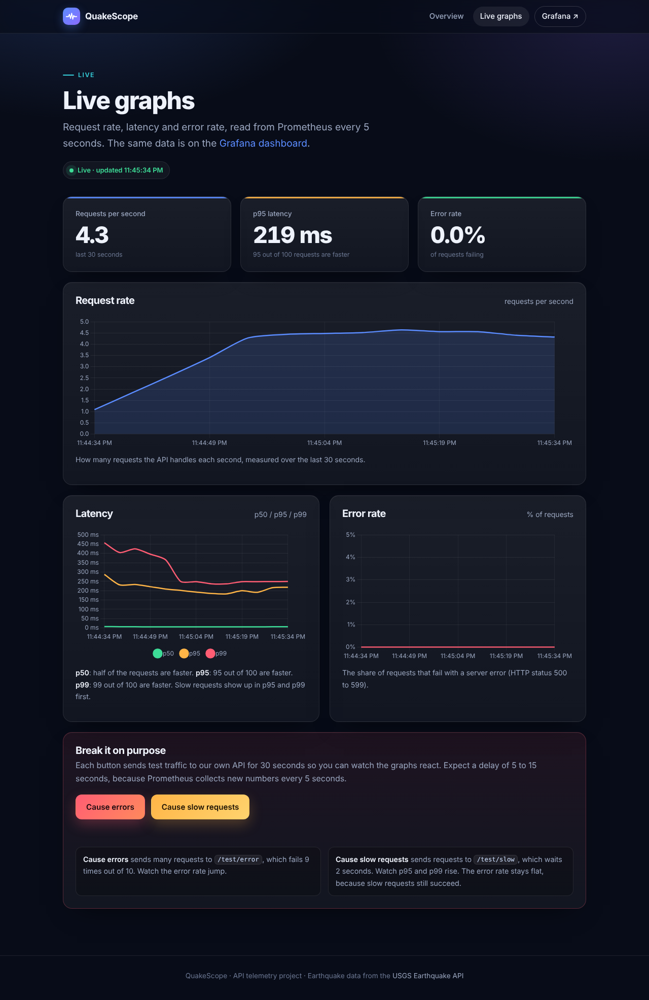
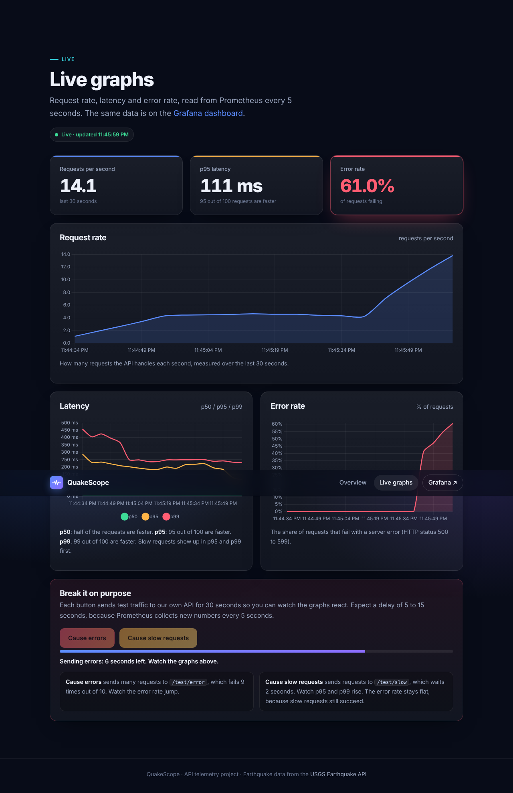
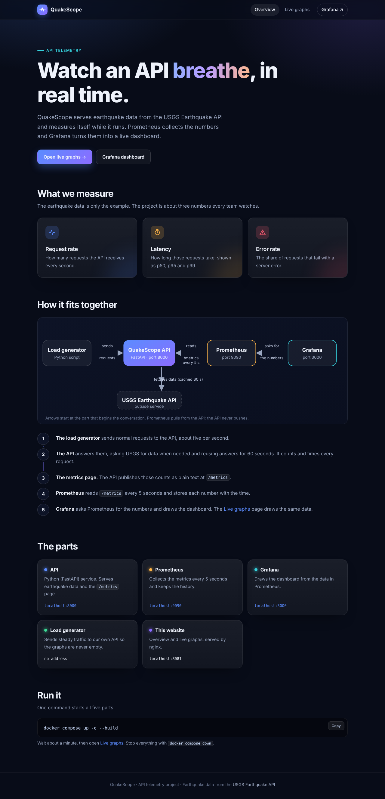
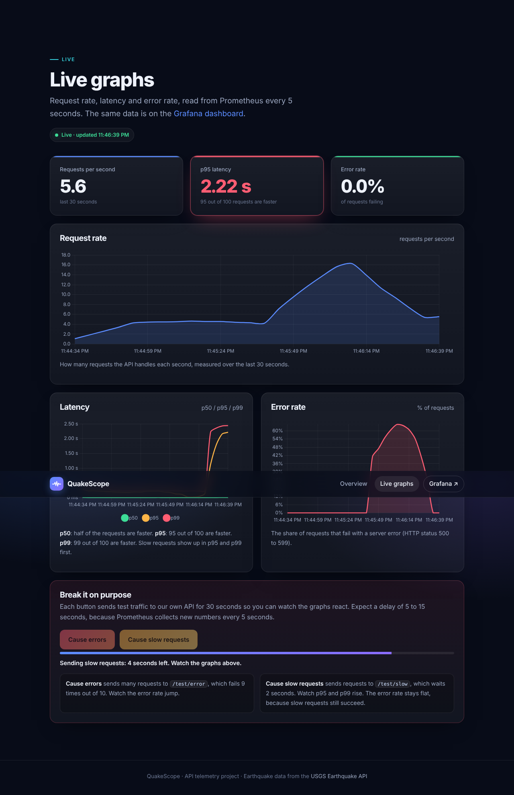

# QuakeScope

**Topic:** Grafana Dashboard for API Telemetry. We expose metrics from an API (the [USGS Earthquake API](https://earthquake.usgs.gov/fdsnws/event/1/)), collect them with Prometheus, and show **request rate**, **latency** and **error rate** on a Grafana dashboard. Everything runs with Docker Compose.

QuakeScope is a small web API that returns recent earthquakes. It counts and times every request and publishes the numbers at `/metrics`. Prometheus collects them every 5 seconds, and Grafana draws them. A small website shows the same numbers live.

## Members and roles

| Member | Roll no. | Role | Parts they own |
|---|---|---|---|
| Simran | S004 | API developer | `api/`: endpoints, metrics, cache, tests |
| Janak | S010 | Prometheus and Docker | `prometheus/`, `docker-compose.yml`, Dockerfiles, `.env.example` |
| Prachi | S019 | Grafana dashboard | `grafana/`: data source, dashboard, PromQL |
| Vanshika | S027 | Website, traffic and docs | `site/`, `loadgen/`, `README.md`, `docs/` |

Every member can explain every part of the project. See [docs/TEAMWORK.md](docs/TEAMWORK.md) for how we split the work and commits.

## How it works

1. The **load generator** sends about 4 requests per second to our API.
2. The **API** answers them. For earthquake data it asks USGS, and it reuses each answer for 60 seconds (a cache). A middleware counts and times every request.
3. The API shows these numbers as plain text at `/metrics`.
4. **Prometheus** visits `/metrics` every 5 seconds (a *scrape*) and stores each value with the time.
5. **Grafana** asks Prometheus for the numbers (using PromQL) and draws the dashboard. Our website's Live graphs page draws the same data.

## What is inside

| Folder | What it is |
|---|---|
| `api/` | The Python (FastAPI) API, its tests and its Dockerfile |
| `prometheus/` | Prometheus settings: which address to scrape and how often |
| `grafana/` | The data source and the dashboard, loaded automatically at start |
| `loadgen/` | A small script that sends steady traffic so graphs are never empty |
| `site/` | A two-page website: overview and live graphs |
| `docs/` | Plain-English explanation, demo script, teamwork notes |
| `docker-compose.yml` | Starts everything |

**Technologies:** Python, FastAPI, prometheus-client, Prometheus, Grafana, Docker Compose, nginx, HTML/CSS/JavaScript, Chart.js, pytest.

## Setup steps

You need **Docker Desktop**.

1. Download or clone this repository and open a terminal **in the folder that contains `docker-compose.yml`**.
2. *(Optional)* Copy `.env.example` to `.env` to change the cache time or the Grafana password. The defaults work without it.
3. Start everything:

   ```
   docker compose up -d --build
   docker compose ps
   ```

4. The first build takes a few minutes. Wait about a minute until all services are running, then open:

| Address | What you see |
|---|---|
| http://localhost:8081 | The website (start here, then open **Live graphs**) |
| http://localhost:3000 | The Grafana dashboard *QuakeScope: API Telemetry* (no login needed) |
| http://localhost:9090/targets | Prometheus: `quakescope-api` should say **UP** |
| http://localhost:8000/metrics | The raw numbers the API publishes |
| http://localhost:8000/docs | The API's own documentation page |

5. Stop everything with `docker compose down`.

If Docker says a port is already in use, another program holds it. Stop that program, or change the left-hand number of the port in `docker-compose.yml` (for example `"8082:80"` for the website).

## Demo in one minute

1. Open the Grafana dashboard. Request rate is steady and errors are 0%.
2. Open the website's **Live graphs** page and press **Cause errors**. After a few seconds the error rate jumps.
3. Press **Cause slow requests**. The p95 and p99 latency rise, but the error rate stays flat.
4. Wait 30 seconds. Everything returns to normal.

The full 10-minute script and likely questions are in [docs/DEMO_AND_VIVA.md](docs/DEMO_AND_VIVA.md).

## The Grafana dashboard

| Panel | Shows |
|---|---|
| Requests per second | How busy the API is (the **R**ate) |
| Error rate | Share of requests failing with a 5xx status (the **E**rrors) |
| p95 latency | 95 out of 100 requests are faster than this (the **D**uration) |
| Request rate by endpoint | Which endpoints receive the traffic |
| Latency percentiles | p50, p95 and p99 over time |
| Error rate over time | The error percentage as a graph |
| Requests by status code | 200 versus 500 and so on |

## Research questions

### What are metrics, logs and traces?

They are three ways a running system can tell us what it is doing.

- **Metrics** are numbers measured over time, such as "40 requests per second". They are cheap to store and good for graphs and alerts. They tell us **that** something is wrong.
- **Logs** are lines of text about single events, such as `GET /health -> 200 in 4 ms`. They tell us **what** happened.
- **Traces** follow one request as it travels through several services and show how long each step took. They tell us **where** the time went.

In our project we use metrics fully (the API, Prometheus and Grafana). The API also prints one log line per request. We do not use traces, because we have only one service, so there is nothing to follow between services.

### How does Prometheus scrape data?

Prometheus **pulls** data; the application does not send it anything. Our API keeps counters in its memory and shows them as plain text at `/metrics`. Every 5 seconds (set in `prometheus/prometheus.yml`) Prometheus visits that page. This visit is called a *scrape*. It reads each line and stores the value with the current time, which builds up a history called a *time series*. Grafana then asks Prometheus questions about that history using PromQL.

Because Prometheus does the visiting, it also notices when something dies: if the API does not answer, the scrape fails and the built-in metric `up` becomes 0.

### What do latency percentiles and error rate show?

**Latency** is how long a request takes. An average can hide slow requests: if 95 requests take 0.1 seconds and 5 take 10 seconds, the average is about 0.6 seconds, yet five users waited 10 seconds. Percentiles show this:

- **p50** is the typical request: half are faster.
- **p95**: 95 out of 100 requests are faster than this value. It shows how bad the slow ones are.
- **p99**: 99 out of 100 are faster. It shows near-worst cases.

Prometheus estimates them from histogram buckets using `histogram_quantile`.

**Error rate** is the share of requests that fail: failed requests divided by all requests. We count a status of 500 to 599 as failed. If 3 out of 100 requests fail, the error rate is 3%. Request rate, error rate and latency together are called the RED method, and they show whether users are getting a healthy service.

## Rate limits, caching and keys

- **No API key** is needed for USGS, so there are no secrets in this repository. Settings live in `.env` (copy it from `.env.example`). `.env` is listed in `.gitignore`, so it is never committed.
- **Caching:** the API reuses each USGS answer for 60 seconds (`CACHE_SECONDS`) and sends a `User-Agent` that names this project.
- **No load testing of a public API:** the load generator and the "break it" buttons talk only to our own API, and the test endpoints never contact USGS. The metric `usgs_lookups_total` shows how many real USGS calls were made (at most about 9 per minute).

## Run the tests

```
cd api
pip install -r requirements-dev.txt
python -m pytest
```

12 tests check the endpoints, the cache, the 502 response when USGS fails, and that every request is counted and timed. They use a fake USGS, so no internet is needed.

## Screenshots

**Website: normal traffic and while errors are being caused**

| Normal traffic | After pressing "Cause errors" |
|---|---|
|  |  |

**Website: overview page and a slow-requests run**

| Overview | After pressing "Cause slow requests" |
|---|---|
|  |  |

**Grafana dashboard:** add your own screenshot here after running the project, for example `docs/screenshots/grafana-dashboard.png`:

```

```

More images are listed in [docs/screenshots/README.md](docs/screenshots/README.md).

## More reading

- [docs/EXPLAINED.md](docs/EXPLAINED.md): how every part works, in plain English
- [docs/TEAMWORK.md](docs/TEAMWORK.md): roles, commit plan and submission checklist
- [docs/DEMO_AND_VIVA.md](docs/DEMO_AND_VIVA.md): demo steps and answers to likely questions

## Honest notes

- The API (12 tests), Prometheus, the website and the load generator were run and tested directly during development, including the "Cause errors" and "Cause slow requests" buttons. The **Docker builds, Compose startup, nginx and the Grafana dashboard have not been run by the author of the code**. If something fails on first start, run `docker compose logs <service>` (for example `docker compose logs grafana`).
- During development the real USGS service was not reachable, so the API was tested against a stand-in. On a normal computer it calls the real service.
- The screenshots in `docs/screenshots` are of the website. Add your own Grafana screenshot before you submit.
